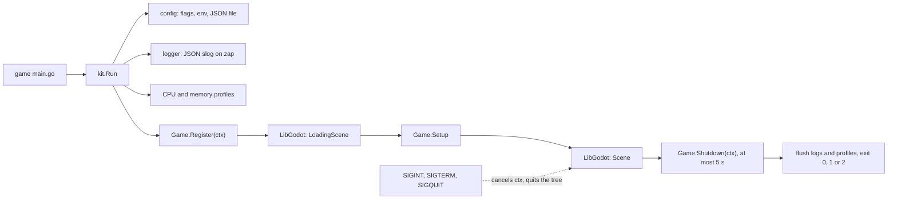

**English** · [Русский](docs/readme/README_ru.md)

# Go Godot Kit

Go Godot Kit, or kit, is the launcher for Go games that embed Godot through LibGodot. It brings flags, config, JSON logs, profiles, the build version and exit on OS signals to every game, next to where you are already writing the game in Go.

> [!IMPORTANT]
> The engine runs on macOS, Linux and Windows, arm64 and amd64, built with cgo: the targets of the libgodot mode of graphics.gd's `gd`. On other platforms a game prints its build version and exits with code 1.

Go Godot Kit is supported for games on [graphics.gd](https://github.com/quaadgras/graphics.gd) `v0.0.0-20261109055115-ea818be6cab0` and Godot 4.7.2, with support for macOS, Linux and Windows on arm64 and amd64.

## Documentation

For [installation options see below](#installation), for usage instructions see the package documentation:

```shell
go doc github.com/shigabutdinoff/go-godot-kit/pkg/kit Run
```

A complete minimal game lives in [`testdata/game`](testdata/game).

## Tools

The module ships three tools for games. Add them with the built-in `go get -tool` command and run them with `go tool`:

```shell
# Add the tools to the game's go.mod
go get -tool github.com/shigabutdinoff/go-godot-kit/cmd/staticlint
go get -tool github.com/shigabutdinoff/go-godot-kit/cmd/reset
go get -tool github.com/shigabutdinoff/go-godot-kit/cmd/libgodot

# Lint the game: go vet analyzers, staticcheck and osexit
go tool staticlint ./...
```

`reset` generates `Reset()` methods for structs marked `// generate:reset`; run it from a `//go:generate go tool reset .` directive. `libgodot` builds the engine for development, see [LibGodot](#libgodot). Package `pkg/pool` reuses objects with such `Reset()` methods: `go doc github.com/shigabutdinoff/go-godot-kit/pkg/pool`.

## Contributing

If anything feels off or if you feel that some functionality is missing, please open an issue. Before sending a pull request, run the same checks as CI:

```shell
go test -race -cover ./...
go run ./cmd/staticlint ./... && golangci-lint run
GOOS=windows go vet ./... && GOOS=windows go build -o /dev/null ./...
```

`go run ./cmd/libgodot` puts LibGodot into `lib/` (git-ignored), then `go test -run TestSmoke -v ./pkg/kit` builds `testdata/game` and runs Godot headless.

## Installation

### Go module

```shell
go get github.com/shigabutdinoff/go-godot-kit@latest && go mod tidy
```

The same command updates kit. Do not add `-u`: the graphics.gd version comes from kit's `go.mod`.

The game's `cmd/<name>/main.go` calls `Run`:

```go
package main

import (
	"runtime"

	kit "github.com/shigabutdinoff/go-godot-kit/pkg/kit"
)

// Set at build time, see Build version below.
var buildVersion, buildDate, buildCommit string

func main() {
	_, src, _, _ := runtime.Caller(0)
	kit.Run(kit.Game{
		Name: "demo", EnvPrefix: "DEMO", Source: src,
		BuildVersion: buildVersion, BuildDate: buildDate, BuildCommit: buildCommit,
	})
}
```

### LibGodot

The development build finds LibGodot in `lib/` at the game root through an rpath in `cmd/<name>/rpath.go`:

```go
//go:build (darwin || linux) && !archive && !musl

package main

// #cgo LDFLAGS: -Wl,-rpath,${SRCDIR}/../../lib
import "C"
```

On Windows kit finds `lib/libgodot.dll` itself. Without LibGodot in `lib/` a development build exits with code 1 before starting the engine.

LibGodot is not published anywhere: build it once per machine from Godot sources, in the game root:

```shell
# Put LibGodot into lib/
go tool libgodot

# Replace LibGodot already in lib/
go tool libgodot -force
```

It builds Godot 4.7.2 for this OS and architecture. It needs these tools and names the missing ones, but does not install them:

- **macOS:** git, Python, scons, Xcode and MoltenVK (`brew install scons molten-vk`)
- **Linux:** git, Python, scons, gcc or clang
- **Windows:** git, Python, scons, MSVC or mingw

The first build takes 5 minutes to an hour; set `SCONSFLAGS=-jN` to use fewer threads. The result stays in the user cache, so the next project on the machine gets it in a second.

Or build Godot `4.7.2-stable` yourself and put `bin/libgodot.*.template_debug.*` into `lib/` as `libgodot.dylib`, `.so` or `.dll`:

```shell
# macOS: add vulkan_sdk_path=<path to MoltenVK.xcframework>, without it OpenGL; Windows: add d3d12=no
scons platform=<macos|linuxbsd|windows> arch=<arm64|x86_64> target=template_debug \
  library_type=shared_library disable_path_overrides=no
```

### Release builds

A release built by `gd` embeds the engine and the scene, so `-project`, `<PREFIX>_PROJECT` and `-- --path` exit it with code 2. A Windows release has no console, so its stderr goes nowhere: to keep its logs, set `log_file` in the config file or `<PREFIX>_LOG_FILE`. On Windows there is no SIGQUIT: a game exits on Ctrl+C, Ctrl+Break and closing the console.

### Build version

```shell
go build -ldflags "-X main.buildVersion=v1.2.3 -X main.buildDate=$(date -u +%F) \
  -X main.buildCommit=$(git rev-parse --short HEAD)" ./cmd/demo
```

Without them the game prints `N/A`. The tools `staticlint`, `reset` and `libgodot` take the same variables and print the same three lines at start.

### GitHub Actions

[CI](.github/workflows/ci.yml) checks kit on six [GitHub-hosted runners](https://docs.github.com/en/actions/reference/runners/github-hosted-runners): macOS, Linux and Windows on arm64 and x64. Each runner builds LibGodot with `go run ./cmd/libgodot` and runs the tests and the smoke test. The Actions cache keeps the engine per OS, architecture and Godot version, so it is built once. `staticlint` and the 70% coverage threshold run on every runner, `staticlint` once more with the release tag; golangci-lint runs on `macos-15`. scons and MoltenVK for the engine build are pinned by version.

## Configuration

A setting comes from, in order of precedence: `<PREFIX>_*` environment variables, flags, the JSON file from `-c`, `-config`, `CONFIG` or `<PREFIX>_CONFIG` (the later one wins), defaults. Run the game with `-h` for the flags.

```json
{
  "project": "graphics",
  "log_level": "debug",
  "log_file": "game.log",
  "cpu_profile": "cpu.out",
  "mem_profile": "mem.out",
  "godot_args": ["--verbose"]
}
```

`godot_args` are used when the command line has no Godot arguments after `--`. Unknown keys and anything after the JSON object are errors with exit code 2.

## Logs

kit writes one JSON object per line to stderr, or appends it to `-log-file` (`<PREFIX>_LOG_FILE`). `-log-level` (`<PREFIX>_LOG_LEVEL`) sets the minimum level: `debug`, `info` (default), `warn` or `error`.

```json
{"level":"ERROR","time":"2026-11-11T15:57:44.885629+03:00","msg":"run failed","service.name":"game","service.version":"v1.2.3","service.instance.id":"7654f754-c032-46f5-b86e-978d3e0e1a90","deployment.environment.name":"production","os.type":"darwin","host.arch":"arm64","exception.message":"project /nonexistent: stat /nonexistent: no such file or directory"}
```

Every record carries the [OpenTelemetry](https://opentelemetry.io/docs/specs/semconv/resource/) resource attributes: `service.name` (`Game.Name`), `service.version` (build version), `service.instance.id` (a new UUID on every run, so records of one run can be told apart), `deployment.environment.name` (`development` or `production` for a release build), `os.type` and `host.arch`. kit's own fields start with `custom.`.

| Level | Records |
|---|---|
| `ERROR` | `run`: the game failed to start or to exit cleanly, with `exception.message` |
| `INFO` | `start`, `exit`, OS signal |
| `DEBUG` | resolved config, LibGodot path, Godot arguments, `engine loaded`, `shutdown` |

Paths inside the user's home directory are written as `~/…` in every record, so a log sent by a player does not carry their OS user name.

The log file is only appended to: kit does not rotate or trim it. A game that turns `-log-file` on for players should rotate it itself, for example by putting the date in the file name.

## Profiling

`-cpuprofile cpu.out` writes a CPU profile from start to exit, `-memprofile mem.out` a heap profile on exit (or `<PREFIX>_CPU_PROFILE` and `<PREFIX>_MEM_PROFILE`). Open them with `go tool pprof`:

```shell
go run ./cmd/demo -cpuprofile cpu.out
go tool pprof -http=:9090 cpu.out
```

Benchmarks cover the log record, config parsing, Godot arguments and the pool: `go test -run '^$' -bench . -benchmem ./...`. [`profiles/`](profiles) keeps the heap profiles of `BenchmarkParse` before and after config files began to be decoded straight from the file instead of being read into memory first. Both profiles are taken over the same 100,000 iterations, so the totals compare directly:

```shell
go test -run '^$' -bench '^BenchmarkParse$' -benchtime=100000x -benchmem -memprofile profiles/result.pprof ./internal/config
go tool pprof -top -diff_base=profiles/base.pprof profiles/result.pprof
```

```text
before: BenchmarkParse-10  100000  11709 ns/op  3598 B/op  49 allocs/op
after:  BenchmarkParse-10  100000  11106 ns/op  2829 B/op  46 allocs/op
```

```text
File: config.test
Type: alloc_space
Time: 2026-11-11 15:59:58 MSK
Showing nodes accounting for -61.52MB, 18.47% of 333.06MB total
Dropped 2 nodes (cum <= 1.67MB)
      flat  flat%   sum%        cum   cum%
  -52.53MB 15.77% 15.77%   -52.53MB 15.77%  os.readFileContents
  -17.50MB  5.26% 21.03%   -17.50MB  5.26%  os.(*File).Stat
      13MB  3.90% 17.12%    11.50MB  3.45%  github.com/shigabutdinoff/go-godot-kit/internal/config.newFlagSet
    6.50MB  1.95% 15.17%     6.50MB  1.95%  encoding/json/jsontext.NewDecoder (inline)
   -5.50MB  1.65% 16.82%    -5.50MB  1.65%  github.com/shigabutdinoff/go-godot-kit/internal/config.(*Config).applyEnv
   -4.50MB  1.35% 18.17%    -4.50MB  1.35%  flag.(*FlagSet).parseOne
   -4.50MB  1.35% 19.52%    -4.50MB  1.35%  bytes.NewReader (inline)
    3.50MB  1.05% 18.47%     3.50MB  1.05%  encoding/json/v2.JoinOptions (inline)
```

## Architecture



```text
cmd/
  libgodot/     builds LibGodot for development
  reset/        generates Reset() methods
  staticlint/   multichecker: go vet passes, staticcheck, osexit
internal/
  config/       flags, env and the JSON file
  atomicfile/   writes a file through a temporary one and a rename
  buildinfo/    the "Build version/date/commit" lines
  errwriter/    writer that keeps the first write error
  launcher/     runs the engine: project lookup, LibGodot, signals, exit codes
  libgodot/     Godot version and LibGodot file names
    build/      clones and builds LibGodot for cmd/libgodot
  logger/       JSON slog on zap
  profile/      CPU and heap profiles
  resetgen/     Reset() generator for cmd/reset
  signals/      quit signals and LibGodot's SIGINT handler (cgo)
pkg/
  kit/          public API: Game, Run, build version
  pool/         generic pool of objects with Reset()
profiles/       heap profiles before and after an optimization
testdata/game/  the smallest game, built by the smoke test
```

## Comparison with graphics.gd startup

[graphics.gd](https://github.com/quaadgras/graphics.gd) starts the engine with `startup.LoadingScene` and `startup.Scene`. kit wraps that pair: before loading it parses settings, opens logs and profiles and calls `Game.Register`; after loading it calls `Game.Setup`, hands SIGINT, SIGTERM and SIGQUIT back to Go, after the engine stops waits for the game in `Game.Shutdown` and exits with code 0, 1 or 2. Check out `go doc` for the project lookup order and the shader cache setting.
