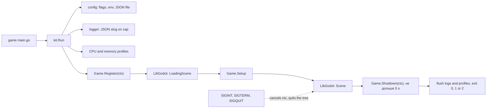

[English](../../README.md) · **Русский**

# Go Godot Kit

Go Godot Kit, или kit, — запускатель для игр на Go со встроенным через LibGodot движком Godot. Он даёт каждой игре флаги, конфиг, JSON-логи, профили, версию сборки и выход по сигналам ОС — там же, где вы уже пишете игру на Go.

> [!IMPORTANT]
> Движок работает на macOS, Linux и Windows, arm64 и amd64, в сборке с cgo — на целях режима libgodot у `gd` из graphics.gd. На других платформах игра печатает версию сборки и выходит с кодом 1.

Go Godot Kit поддерживает игры на [graphics.gd](https://github.com/quaadgras/graphics.gd) `v0.0.0-20261109055115-ea818be6cab0` и Godot 4.7.2, платформы — macOS, Linux и Windows на arm64 и amd64.

## Документация

[Варианты установки — ниже](#установка), инструкции по использованию — в документации пакета:

```shell
go doc github.com/shigabutdinoff/go-godot-kit/pkg/kit Run
```

Полная минимальная игра лежит в [`testdata/game`](../../testdata/game).

## Инструменты

Модуль поставляет играм три инструмента. Добавьте их встроенной командой `go get -tool` и запускайте через `go tool`:

```shell
# Добавить инструменты в go.mod игры
go get -tool github.com/shigabutdinoff/go-godot-kit/cmd/staticlint
go get -tool github.com/shigabutdinoff/go-godot-kit/cmd/reset
go get -tool github.com/shigabutdinoff/go-godot-kit/cmd/libgodot

# Проверить игру: анализаторы go vet, staticcheck и osexit
go tool staticlint ./...
```

`reset` генерирует методы `Reset()` для структур с пометкой `// generate:reset`; запускайте его директивой `//go:generate go tool reset .`. `libgodot` собирает движок для разработки, см. [LibGodot](#libgodot). Пакет `pkg/pool` переиспользует объекты с такими методами `Reset()`: `go doc github.com/shigabutdinoff/go-godot-kit/pkg/pool`.

## Участие в разработке

Если что-то работает не так или вам не хватает какой-то возможности, откройте issue. Перед pull request запустите те же проверки, что и CI:

```shell
go test -race -cover ./...
go run ./cmd/staticlint ./... && golangci-lint run
GOOS=windows go vet ./... && GOOS=windows go build -o /dev/null ./...
```

`go run ./cmd/libgodot` кладёт LibGodot в `lib/` (git её игнорирует), после этого `go test -run TestSmoke -v ./pkg/kit` собирает `testdata/game` и запускает Godot без окна.

## Установка

### Go-модуль

```shell
go get github.com/shigabutdinoff/go-godot-kit@latest && go mod tidy
```

Та же команда обновляет kit. Не добавляйте `-u`: версия graphics.gd берётся из `go.mod` kit.

`cmd/<имя>/main.go` игры вызывает `Run`:

```go
package main

import (
	"runtime"

	kit "github.com/shigabutdinoff/go-godot-kit/pkg/kit"
)

// Задаются при сборке, см. «Версия сборки» ниже.
var buildVersion, buildDate, buildCommit string

func main() {
	_, src, _, _ := runtime.Caller(0)
	kit.Run(kit.Game{
		Name: "demo", EnvPrefix: "DEMO", Source: src,
		BuildVersion: buildVersion, BuildDate: buildDate, BuildCommit: buildCommit,
	})
}
```

### LibGodot

Сборка для разработки находит LibGodot в `lib/` в корне игры через rpath в `cmd/<имя>/rpath.go`:

```go
//go:build (darwin || linux) && !archive && !musl

package main

// #cgo LDFLAGS: -Wl,-rpath,${SRCDIR}/../../lib
import "C"
```

На Windows kit сам находит `lib/libgodot.dll`. Без LibGodot в `lib/` сборка для разработки выходит с кодом 1 до старта движка.

LibGodot нигде не публикуется: соберите её один раз на машине из исходников Godot, в корне игры:

```shell
# Положить LibGodot в lib/
go tool libgodot

# Заменить LibGodot, которая уже лежит в lib/
go tool libgodot -force
```

Он собирает Godot 4.7.2 под текущие ОС и архитектуру. Ему нужны эти инструменты; он называет недостающие, но сам их не ставит:

- **macOS:** git, Python, scons, Xcode и MoltenVK (`brew install scons molten-vk`)
- **Linux:** git, Python, scons, gcc или clang
- **Windows:** git, Python, scons, MSVC или mingw

Первая сборка занимает от 5 минут до часа; потоков станет меньше с `SCONSFLAGS=-jN`. Результат остаётся в кэше пользователя, поэтому следующий проект на машине получает его за секунду.

Или соберите Godot `4.7.2-stable` сами и положите `bin/libgodot.*.template_debug.*` в `lib/` как `libgodot.dylib`, `.so` или `.dll`:

```shell
# macOS: добавьте vulkan_sdk_path=<путь к MoltenVK.xcframework>, без него OpenGL; Windows: добавьте d3d12=no
scons platform=<macos|linuxbsd|windows> arch=<arm64|x86_64> target=template_debug \
  library_type=shared_library disable_path_overrides=no
```

### Релиз

Релиз, собранный `gd`, несёт движок и сцену внутри, поэтому `-project`, `<ПРЕФИКС>_PROJECT` и `-- --path` завершают его с кодом 2. Релиз под Windows — без консоли, и его stderr никуда не попадает: чтобы сохранить логи, задайте `log_file` в файле конфига или `<ПРЕФИКС>_LOG_FILE`. На Windows нет SIGQUIT: игра выходит по Ctrl+C, Ctrl+Break и закрытию консоли.

### Версия сборки

```shell
go build -ldflags "-X main.buildVersion=v1.2.3 -X main.buildDate=$(date -u +%F) \
  -X main.buildCommit=$(git rev-parse --short HEAD)" ./cmd/demo
```

Без них игра печатает `N/A`. Утилиты `staticlint`, `reset` и `libgodot` принимают те же переменные и печатают те же три строки при старте.

### GitHub Actions

[CI](../../.github/workflows/ci.yml) проверяет kit на шести [раннерах GitHub](https://docs.github.com/ru/actions/reference/runners/github-hosted-runners): macOS, Linux и Windows на arm64 и x64. Каждый раннер собирает LibGodot командой `go run ./cmd/libgodot` и запускает тесты и smoke-тест. Движок лежит в кэше Actions по ОС, архитектуре и версии Godot, поэтому собирается один раз. `staticlint` и порог покрытия 70% проверяются на каждом раннере, `staticlint` ещё раз с тегом релиза; golangci-lint — на `macos-15`. Версии scons и MoltenVK для сборки движка закреплены.

## Настройки

Настройка берётся по убыванию приоритета: переменные окружения `<ПРЕФИКС>_*`, флаги, JSON-файл из `-c`, `-config`, `CONFIG` или `<ПРЕФИКС>_CONFIG` (побеждает последний), значения по умолчанию. Флаги выводит запуск игры с `-h`.

```json
{
  "project": "graphics",
  "log_level": "debug",
  "log_file": "game.log",
  "cpu_profile": "cpu.out",
  "mem_profile": "mem.out",
  "godot_args": ["--verbose"]
}
```

`godot_args` действуют, если в командной строке нет аргументов Godot после `--`. Неизвестные ключи и данные после JSON-объекта — ошибка с кодом выхода 2.

## Логи

kit пишет по одному JSON-объекту на строку в stderr или дописывает их в `-log-file` (`<ПРЕФИКС>_LOG_FILE`). `-log-level` (`<ПРЕФИКС>_LOG_LEVEL`) задаёт минимальный уровень: `debug`, `info` (по умолчанию), `warn` или `error`.

```json
{"level":"ERROR","time":"2026-11-11T15:57:44.885629+03:00","msg":"run failed","service.name":"game","service.version":"v1.2.3","service.instance.id":"7654f754-c032-46f5-b86e-978d3e0e1a90","deployment.environment.name":"production","os.type":"darwin","host.arch":"arm64","exception.message":"project /nonexistent: stat /nonexistent: no such file or directory"}
```

В каждой записи есть атрибуты ресурса [OpenTelemetry](https://opentelemetry.io/docs/specs/semconv/resource/): `service.name` (`Game.Name`), `service.version` (версия сборки), `service.instance.id` (новый UUID при каждом запуске, чтобы отличать записи одного запуска), `deployment.environment.name` (`development` или `production` у релизной сборки), `os.type` и `host.arch`. Собственные поля kit начинаются с `custom.`.

| Уровень | Записи |
|---|---|
| `ERROR` | `run`: игра не запустилась или не завершилась штатно, с `exception.message` |
| `INFO` | `start`, `exit`, сигнал ОС |
| `DEBUG` | итоговые настройки, путь к LibGodot, аргументы Godot, `engine loaded`, `shutdown` |

Пути внутри домашнего каталога пишутся во всех записях как `~/…`, поэтому лог, присланный игроком, не содержит его имя пользователя в ОС.

Файл лога только дописывается: kit его не ротирует и не обрезает. Если игра включает `-log-file` у игроков, ротацию она делает сама, например добавляя дату в имя файла.

## Профилирование

`-cpuprofile cpu.out` пишет профиль CPU от старта до выхода, `-memprofile mem.out` — профиль кучи при выходе (или `<ПРЕФИКС>_CPU_PROFILE` и `<ПРЕФИКС>_MEM_PROFILE`). Смотреть через `go tool pprof`:

```shell
go run ./cmd/demo -cpuprofile cpu.out
go tool pprof -http=:9090 cpu.out
```

Бенчмарки измеряют запись лога, разбор настроек, аргументы Godot и пул: `go test -run '^$' -bench . -benchmem ./...`. В [`profiles/`](../../profiles) лежат профили кучи `BenchmarkParse` до и после того, как JSON-файл настроек стал декодироваться прямо из файла, без чтения в память целиком. Оба профиля сняты на одинаковых 100 000 итерациях, поэтому итоги сравнимы напрямую:

```shell
go test -run '^$' -bench '^BenchmarkParse$' -benchtime=100000x -benchmem -memprofile profiles/result.pprof ./internal/config
go tool pprof -top -diff_base=profiles/base.pprof profiles/result.pprof
```

```text
до:    BenchmarkParse-10  100000  11709 ns/op  3598 B/op  49 allocs/op
после: BenchmarkParse-10  100000  11106 ns/op  2829 B/op  46 allocs/op
```

```text
File: config.test
Type: alloc_space
Time: 2026-11-11 15:59:58 MSK
Showing nodes accounting for -61.52MB, 18.47% of 333.06MB total
Dropped 2 nodes (cum <= 1.67MB)
      flat  flat%   sum%        cum   cum%
  -52.53MB 15.77% 15.77%   -52.53MB 15.77%  os.readFileContents
  -17.50MB  5.26% 21.03%   -17.50MB  5.26%  os.(*File).Stat
      13MB  3.90% 17.12%    11.50MB  3.45%  github.com/shigabutdinoff/go-godot-kit/internal/config.newFlagSet
    6.50MB  1.95% 15.17%     6.50MB  1.95%  encoding/json/jsontext.NewDecoder (inline)
   -5.50MB  1.65% 16.82%    -5.50MB  1.65%  github.com/shigabutdinoff/go-godot-kit/internal/config.(*Config).applyEnv
   -4.50MB  1.35% 18.17%    -4.50MB  1.35%  flag.(*FlagSet).parseOne
   -4.50MB  1.35% 19.52%    -4.50MB  1.35%  bytes.NewReader (inline)
    3.50MB  1.05% 18.47%     3.50MB  1.05%  encoding/json/v2.JoinOptions (inline)
```

## Архитектура



```text
cmd/
  libgodot/     собирает LibGodot для разработки
  reset/        генерирует методы Reset()
  staticlint/   multichecker: анализаторы go vet, staticcheck, osexit
internal/
  config/       флаги, env и JSON-файл
  atomicfile/   пишет файл через временный и переименование
  buildinfo/    строки «Build version/date/commit»
  errwriter/    writer, который запоминает первую ошибку записи
  launcher/     запуск движка: поиск проекта, LibGodot, сигналы, коды выхода
  libgodot/     версия Godot и имена файлов LibGodot
    build/      клонирует и собирает LibGodot для cmd/libgodot
  logger/       JSON slog поверх zap
  profile/      профили CPU и кучи
  resetgen/     генератор Reset() для cmd/reset
  signals/      сигналы выхода и обработчик SIGINT из LibGodot (cgo)
pkg/
  kit/          публичный API: Game, Run, версия сборки
  pool/         generic-пул объектов с Reset()
profiles/       профили кучи до и после оптимизации
testdata/game/  минимальная игра для smoke-теста
```

## Сравнение с startup из graphics.gd

[graphics.gd](https://github.com/quaadgras/graphics.gd) запускает движок через `startup.LoadingScene` и `startup.Scene`. kit оборачивает эту пару: до загрузки он разбирает настройки, открывает логи и профили и вызывает `Game.Register`; после загрузки вызывает `Game.Setup`, возвращает SIGINT, SIGTERM и SIGQUIT в Go, после остановки движка ждёт игру в `Game.Shutdown` и выходит с кодом 0, 1 или 2. Порядок поиска проекта и настройку кэша шейдеров смотрите в `go doc`.
